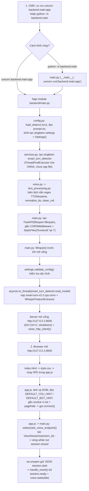
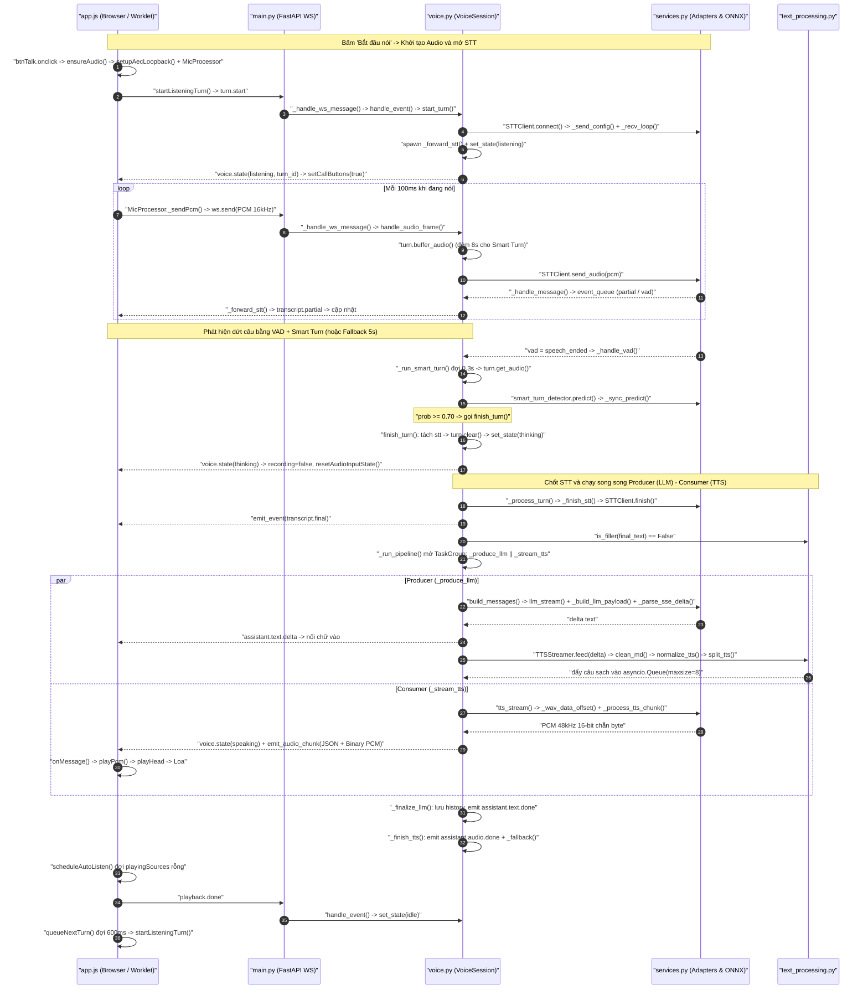
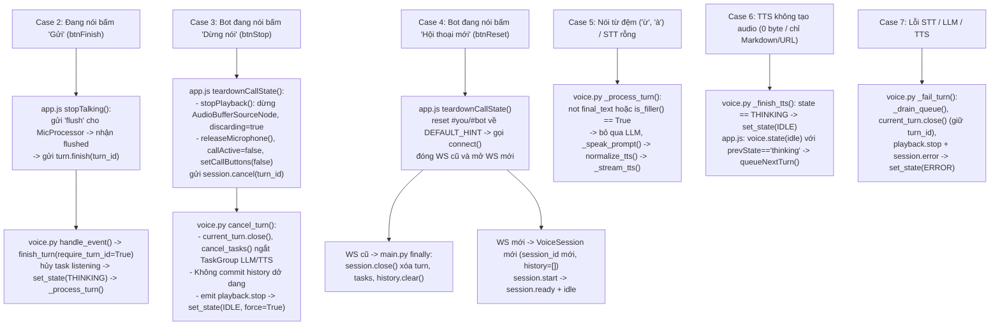

# 05 -- Báo Cáo Chi Tiết Luồng Vận Hành & Kiểm Định Tài Liệu Voicebot MVP

Tài liệu này tổng hợp đầy đủ luồng chạy thực tế theo từng hàm và file của hệ thống Voicebot MVP từ lúc gõ lệnh khởi chạy trên `CMD` / `PowerShell`, mở trình duyệt cho đến mọi kịch bản tương tác, kèm bảng đối chiếu tình trạng đồng bộ của bộ tài liệu dự án (`docs/01..04` và `README.md`).

---

## Phần I. Luồng Chạy Từ Lệnh CMD Đến Khi Trình Duyệt Sẵn Sàng (Bootstrap)

### Thứ tự gọi hàm chi tiết khi khởi động

| Bước | File                                                                               | Hàm / Thành phần           | Nhiệm vụ thực hiện                                                                                                                                                                                                                                                                     |
| :----- | :--------------------------------------------------------------------------------- | :---------------------------- | :----------------------------------------------------------------------------------------------------------------------------------------------------------------------------------------------------------------------------------------------------------------------------------------- |
| 1      | [`main.py`](../backend/main.py#L125-L135)                                         | Khối `__main__`            | Nếu chạy bằng `python -m backend.main`, gọi `uvicorn.run("backend.main:app", host, port, reload, app_dir)`.                                                                                                                                                                        |
| 2      | [`config.py`](../backend/config.py#L17-L174)                                      | Module init & `Settings()`  | Tìm nạp `.env` bằng `load_dotenv()`, đọc [`prompt.txt`](../backend/prompt.txt) vào `DEFAULT_SYSTEM_PROMPT`, tạo singleton `settings`.                                                                                                                                      |
| 3      | [`services.py`](../backend/services.py#L505-L597)                                 | `SmartTurnDetector()`       | Khởi tạo singleton `smart_turn_detector` kèm `ThreadPoolExecutor` (chưa nạp mô hình ONNX).                                                                                                                                                                                      |
| 4      | [`text_processing.py`](../backend/text_processing.py#L1-L380)                     | Module init                   | Được [`voice.py`](../backend/voice.py#L25) import; biên dịch sẵn toàn bộ regex lọc từ đệm, Markdown, chuẩn hóa số/ngày/tiền và tách câu.                                                                                                                              |
| 5      | [`main.py`](../backend/main.py#L37-L46)                                           | `lifespan()`                | Trước `yield`: gọi `settings.validate_config()`, chạy `smart_turn_detector.load_model()` trong `asyncio.to_thread` để nạp ONNX + `WhisperFeatureExtractor(chunk_length=8)`. Sau `yield` (lúc `Ctrl+C` tắt server): gọi `shutdown()` và `close_http_client()`. |
| 6      | [`main.py`](../backend/main.py#L49-L123)                                          | `FastAPI` + `StaticFiles` | Gắn CORS middleware, đăng ký `/health`, `/ws/voice` và mount thư mục `frontend/` tại `/`.                                                                                                                                                                                  |
| 7      | [`index.html`](../frontend/index.html) & [`app.js`](../frontend/app.js#L45-L179) | `connect()`                 | Trình duyệt tải HTML/CSS/JS, đọc `data-placeholder` mặc định từ HTML, mở WebSocket `/ws/voice` → backend tạo `VoiceSession` tại `websocket_voice_endpoint()`. `ws.onopen` gửi `session.start` → backend trả `session.ready` + `voice.state = "idle"`.      |

---

## Phần II. Luồng Nghiệp Vụ Chuẩn: Nói Bình Thường (Smart Turn → LLM → TTS → Loa)

### Chi tiết xử lý ở từng tầng

1. **Thu âm & chống dội âm ([`app.js`](../frontend/app.js#L65-L121), [`L288-L384`](../frontend/app.js#L288-L384)):**
   - `ensureAudio()` tạo `AudioContext`, dựng `setupAecLoopback()` (2 `RTCPeerConnection` nối audio TTS vào thẻ `<audio>` để kích hoạt Acoustic Echo Cancellation của trình duyệt), lọc mic qua `highpass 85Hz` + `lowpass Butterworth 7.2kHz`, rồi `AudioWorklet` (`MicProcessor`) resample xuống **16 kHz Mono PCM16LE** và gửi mỗi 100ms (`1600` samples = `3200` bytes).
2. **Đệm audio & đánh giá dứt câu ([`voice.py`](../backend/voice.py#L479-L605)):**
   - `handle_audio_frame()` thực hiện 3 tác vụ: lưu đệm vòng tối đa ~8s (`buffer_audio`), đẩy frame sang Qwen3-ASR (`send_audio`), và kiểm tra timeout im lặng dự phòng `is_silence_timeout()` (mặc định 5s).
   - Khi nhận VAD `speech_ended`, `_handle_vad()` chạy `_run_smart_turn()` (ngủ 0.3s debounce → gọi `smart_turn_detector.predict()` chuẩn hóa zero-mean/unit-variance + pad trái 8s trên ONNX → nếu `prob >= 0.70` tự động gọi `finish_turn()`).
3. **Chuẩn hóa giọng đọc & Streaming song song ([`text_processing.py`](../backend/text_processing.py), [`voice.py`](../backend/voice.py#L296-L418)):**
   - `_produce_llm()` đẩy nguyên văn token `assistant.text.delta` về UI, đồng thời đưa qua `TTSStreamer`: `clean_md()` (xóa ký hiệu Markdown/URL) → ghép câu quá ngắn (`< 8` ký tự) → capping (`max_sentences = 8`, `max_chars = 600`) → `normalize_tts()` (đọc hotline, SĐT, ngày tháng, khoảng giá trị/thời gian, đơn vị đo, thuật ngữ công nghệ, mã vận đơn) → `split_tts()` (cắt đoạn ≤ 450 ký tự) → đẩy vào `queue`.
   - `_stream_tts()` rút từng câu gọi `tts_stream()`, bóc RIFF/WAVE header động qua `_wav_data_offset()` + căn chẵn sample 16-bit qua `_process_tts_chunk()`, rồi gọi `emit_audio_chunk()` gửi liền cặp `[JSON metadata, Binary PCM]` dưới một `send_lock`.
4. **Lập lịch phát loa & tự nghe lại ([`app.js`](../frontend/app.js#L410-L494)):**
   - `playPcm()` tạo `Int16Array` view chẵn byte (zero-copy), chuyển sang `AudioBuffer` 48 kHz và xếp nối tiếp theo `playHead`.
   - Khi nhận `assistant.audio.done`, `scheduleAutoListen()` chờ `playingSources` rỗng → gửi `playback.done` → gọi `queueNextTurn()` đợi 600ms rồi gọi `startListeningTurn()` mở lượt nghe kế tiếp.

---

## Phần III. Các Kịch Bản Điều Khiển & Tình Huống Đặc Biệt

| Kịch bản                                                    | Hành vi nổi bật & Bảo vệ an toàn                                                                                                                                                                                                      |
| :------------------------------------------------------------ | :------------------------------------------------------------------------------------------------------------------------------------------------------------------------------------------------------------------------------------------ |
| **Case 2 — Đang nói bấm "Gửi"**                    | `stopTalking()` flush nốt phần audio lẻ `< 100ms` trong `MicProcessor` (kèm timer fallback 500ms); nếu Smart Turn vừa tự chốt turn trùng lúc bấm, `turn_lock` + kiểm tra `VoiceState.LISTENING` chặn xử lý trùng. |
| **Case 3 — Đang nghe/xử lý/nói bấm "Dừng nói"** | Frontend ngắt ngay mọi `AudioBufferSourceNode` và đặt `discarding = true` để bỏ các chunk trôi giữa mạng. Backend hủy `TaskGroup` LLM/TTS và giữ nguyên quy tắc không ghi lượt dở dang vào `history`.         |
| **Case 4 — Bấm "Hội thoại mới"**                   | Frontend dừng mic/loa, khôi phục placeholder từ HTML, đóng WS cũ (kích hoạt `finally: await session.close()` dọn RAM trên backend) và mở WS + `VoiceSession` mới.                                                         |
| **Case 5 — Chỉ nói từ đệm / im lặng**            | `is_filler()` chặn gọi LLM, gọi `_speak_prompt()` phát câu nhắc ngắn qua ZeroTTS và không đưa vào `history`.                                                                                                              |
| **Case 6 — TTS rỗng (`THINKING -> IDLE`)**          | `app.js` nhận `voice.state = "idle"` khi `prevState === "thinking"` sẽ tự gọi `queueNextTurn()` mở mic tiếp sau 600ms, tránh kẹt `"Chờ nghe tiếp..."`.                                                                  |
| **Case 7 — Lỗi dịch vụ**                            | `_fail_turn()` xả queue, đóng tài nguyên trong turn nhưng giữ `turn_id` cho event lỗi, và khóa state ở `ERROR` cho đến khi người dùng bấm nói lại hoặc Reset.                                                     |